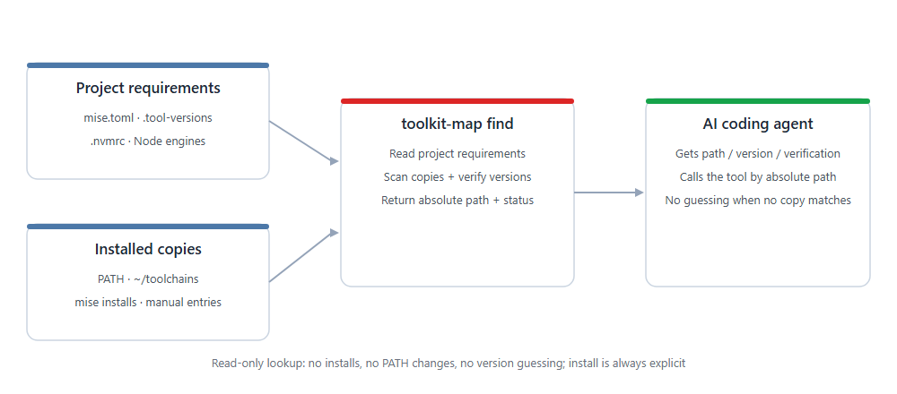

<div align="center">

# toolkit-map

**Let AI coding agents look up tools before they run them: find the copies installed on this machine, pick the version the project requires, and get a verified absolute path.**

[](https://github.com/haxsd/toolkit-map/actions/workflows/ci.yml)
[](https://github.com/haxsd/toolkit-map/releases/latest)
[](LICENSE)
[](docs/platform-notes.md)

English · [简体中文](README.md) · [Quick start](#quick-start) · [Reference](docs/reference.md) · [Agent integration](docs/agent-integration.md) · [Changelog](CHANGELOG.md)

</div>



## The problem

AI coding agents usually run `node`, `python` or `git` straight from `PATH`. That breaks in three common ways:

- `PATH` points at Node 16 while the project requires Node 22 — the build fails and the agent keeps guessing;
- several copies exist on the machine (`PATH`, `~/toolchains`, mise installs) and the agent cannot tell which one to use;
- `node --version` only says who `PATH` resolves to, not which version the project requires.

`toolkit-map` answers three questions before the tool call:

1. **What does the project require?** It reads common declarations such as `mise.toml`, `.tool-versions`, `.nvmrc` and Node `engines`.
2. **Which verified copies exist locally?** It scans `PATH`, tool warehouses, mise installs and manually registered paths.
3. **Which absolute path should be used now?** It returns `path`, `version`, `verification` and `requirement`.

**Lookup only — no installs, no PATH changes, no version guessing.** When no copy satisfies the requirement it returns `version_mismatch` instead of silently falling back; when a declaration cannot be interpreted it returns `requirement_unsupported` and leaves the decision to a version manager or a human.

## How it differs from PATH / mise / asdf

| | Plain PATH | mise / asdf | toolkit-map |
|---|---|---|---|
| Knows project requirements | No | Yes | Yes (reads common declarations) |
| Discovers existing copies | Only one | Only its own installs | PATH, tool warehouses, mise installs, manual entries |
| Returns a verified absolute path | No | Partly | Yes (`version` + `verification` + `requirement`) |
| Requires installs / PATH changes | — | Yes | No (`install` is a separate, explicit action) |
| Fits | Single version | Multi-version | Multi-version plus the tools already on a Windows machine |

> `toolkit-map` does not replace mise / asdf. It completes the chain "project requirement → which local copy → absolute path"; installing stays with a version manager, or with an explicit `install` when you really need it.

## What a lookup returns

Say `PATH` points at Node 16, another Node 22 exists, and the project requires Node 22:

| Situation | toolkit-map returns | What the agent does next |
|---|---|---|
| Verified Node 16 and 22 are found | Node 22, matching the project, with its absolute path | Calls the tool through that path |
| Only Node 16 is found in scope | `version_mismatch`, no path for the wrong version | Reports the gap; installs only if explicitly needed |
| The declaration cannot be interpreted | `requirement_unsupported` | Asks for clarification or hands off to a manager |

Key fields of a successful lookup (example paths, not your machine):

```json
{
  "ok": true,
  "status": "ok",
  "path": "C:\\tools\\node\\22\\node.exe",
  "version": "22.23.2",
  "verification": "verified",
  "requirement": { "version": "22", "scope": "project", "source": "C:\\project\\mise.toml" }
}
```

## Quick start

**Requirements:** Windows, Windows PowerShell 5.1 or PowerShell 7, and Git. MCP access additionally needs Node.js 18+; the map itself does not depend on Node.

Want to see it first? Run `.\scripts\demo.ps1` from the source directory (temporary map, no changes to your machine). To download, wire up the project and print the MCP config in one paste:

```powershell
$d = Join-Path $env:USERPROFILE 'Projects\toolkit-map'
git clone --branch v1.1.1 --depth 1 https://github.com/haxsd/toolkit-map $d
& powershell -NoProfile -ExecutionPolicy Bypass -File "$d\scripts\quickstart.ps1" -Project (Get-Location).Path -Mcp -WriteMcp
```

`quickstart` writes the project `AGENTS.md` and prints the MCP config; it does not overwrite existing servers in client config files. If you ran the block above, skip to step 2; the step-by-step route follows. Add `-WriteMcp` to write the project-level Cursor `.cursor/mcp.json` (default) or Claude Code `.mcp.json` (`-McpClient claude` / `both`); existing entries are preserved and the file is backed up first.

### 1. Download the stable release

Open PowerShell in the project you want to wire up and run:

```powershell
$project = (Get-Location).Path
$installDir = Join-Path $env:USERPROFILE 'Projects\toolkit-map'
git clone --branch v1.1.1 --depth 1 https://github.com/haxsd/toolkit-map $installDir
if ($LASTEXITCODE -ne 0) { throw 'Download did not finish. If you already have an install, follow the upgrade guide instead of overwriting.' }
$map = Join-Path $installDir 'scripts\map.ps1'
$ps = (Get-Process -Id $PID).Path
# `toolkit` is a thin wrapper: run map.ps1 once with the current PowerShell host
function toolkit { & $ps -NoProfile -ExecutionPolicy Bypass -File $map @args }
```

Already installed? See the [upgrade steps](docs/agent-integration.md). No Git, or prefer a ZIP? Use the [ZIP route](docs/agent-integration.md).

### 2. Preview and wire up the project

```powershell
toolkit setup -Project $project -WhatIf -Json
toolkit setup -Project $project
toolkit doctor -Project $project -Json
toolkit find git -Project $project
```

`setup` builds the map on first run and writes the rules into the project's `AGENTS.md` (existing content is preserved and backed up before edits). It does not install runtimes or modify `PATH`. The first scan takes as long as candidate discovery and version probing require.

`doctor` returns `ok: true` and `status: ok` when healthy. `find git` shows the absolute path, version and `verified` status. When something is off, follow the `checks` and see [troubleshooting](docs/troubleshooting.md).

### 3. Verify it inside the agent

Open a new Cursor Agent Chat or Codex session in the same project and send:

> Follow this project's tool discovery rules and look up Git. Do not install anything or change the environment; report the project requirement, the copies found, the absolute path you selected and its verification status. After verification, run `--version` through that absolute path.

Success means you see the agent **actually call the map, then call the returned tool path**. `doctor` only checks local configuration; it cannot prove the model loaded or followed the rules. If the model runs bare `git`, follow the [rules-not-applied checklist](docs/troubleshooting.md).

### Common commands

```powershell
toolkit status -Json                        # map freshness, PATH changes
toolkit find node -Project $project -Json   # requirement + absolute path
toolkit add node -Path 'C:\existing-node\node.exe' -Json   # register an existing copy
toolkit install rg@latest -WhatIf -Json     # preview the plan without network access
```

Full commands, statuses, adapters and declaration rules are in the [reference](docs/reference.md).

## MCP access (recommended)

When the client supports MCP, you do not need to paste rules into every project. Ask the map for a verified Node 18+ path, generate the config and paste it once. The commands below assume `$map` and `$installDir` from step 1:

```powershell
# 1. Find a verified Node 18+ through the map, not the old PATH entry
$node = (& $map find node -Version '>=18' -Json | ConvertFrom-Json).path

# 2. Print the mcpServers JSON for Cursor / Claude Code; use --print-config codex for TOML
& $node (Join-Path $installDir 'mcp\server.mjs') --print-config

# 3. Verify the server and the map without an MCP client
& $node (Join-Path $installDir 'mcp\server.mjs') --check
```

Merge the output into `~/.cursor/mcp.json` (or the project's `.cursor/mcp.json`), Claude Code's `.mcp.json`, or Codex's `~/.codex/config.toml`, then restart the client. A new session should expose the three read-only tools `toolkit_find`, `toolkit_status` and `toolkit_doctor`.

MCP and rule files can coexist. MCP does not rewrite `AGENTS.md`, and `setup` does not write MCP config. See [MCP access](docs/mcp.md) for client-specific config, protocol versions and troubleshooting.

## Supported agents

| Agent | Across projects | Current project only |
|---|---|---|
| Cursor | Customize → Rules → User Rules (paste manually) | Project `AGENTS.md`, or an MDC file with `alwaysApply` |
| Codex | `CODEX_HOME/AGENTS.md`, default `~/.codex/AGENTS.md` | Project `AGENTS.md` |
| Claude Code | `~/.claude/CLAUDE.md` | Project `CLAUDE.md` |

Any agent that can read a rules file can be wired up. Full locations, templates and verification steps are in the [agent integration guide](docs/agent-integration.md).

## Scope

| Capability | Supported now | Boundaries |
|---|---|---|
| Discover installed tools | Registered paths, `PATH`, the tool warehouse, mise installs and locations found by the scanner | Not an exhaustive disk scan; register other locations with `add` |
| Verify and select | Path, version and verification status for runtimes and CLIs; selection follows project requirements | Unknown tools are probed with `--version` by default; special arguments need an adapter; **without a declaration it respects the system default instead of upgrading** |
| Project declarations | Common `mise.toml`, `.tool-versions`, Node/Python version files and Node `engines` | Lightweight reader; does not interpret full TOML / mise environment semantics |
| Portable installs | gh, jadx, rg/ripgrep, fd (Windows x64), adb; custom ZIP | Does not auto-install every discoverable tool; downloaded versions are verified again at the final location |
| MCP access | `toolkit_find` / `toolkit_status` / `toolkit_doctor`, zero npm dependencies | Requires Node.js 18+; read-only, no install or scan tools |
| Interface contract | v1.0 freezes JSON result v2, map v2, 30 status values and the MCP tool contract | Compatibility and deprecation policy in the [contract](docs/contract.md) |
| Installers | Explicit `-Via winget` | Location is decided by the package manager |
| Platforms | Windows PowerShell 5.1 / 7 support the full map | On Unix, only the `census.sh` scanning kernel is available |

## Safety boundaries

- **Read-only by default**: `scan` / `status` / `find` / `doctor` do not install tools, change `PATH` or write configuration.
- **Installs are explicit**: `install` must be called on purpose; run it with `-WhatIf` first to see the plan without network access.
- **Backups before edits**: `setup` only maintains the rules file you point it at; existing content is preserved and backed up first.
- **Verification is explicit**: `verified` / `unverified` / `unavailable` / `skipped` are never mixed up, and unverified copies are not selected by default.
- **No credentials in releases**: local maps, tools, caches and credentials are not part of the published package.
- **No global execution-policy changes**: the script runs once through the current host; organizational group policy still applies.

## Documentation

Reference · agent integration · platform notes · storage and large installs · troubleshooting · uninstall · contributing · changelog:

[Reference](docs/reference.md) · [Contract](docs/contract.md) · [MCP access](docs/mcp.md) · [2-minute demo](docs/demo.md) · [Agent integration](docs/agent-integration.md) · [Platform notes](docs/platform-notes.md) · [Storage](docs/storage.md) · [Troubleshooting](docs/troubleshooting.md) · [Uninstall](docs/uninstall.md) · [Contributing](docs/contributing.md) · [Security](SECURITY.md) · [Changelog](CHANGELOG.md)

> The docs are currently written in Chinese; English translations are welcome. The README and the CLI's `-Lang en` output are the English entry points.

## FAQ

- **Without a project declaration, will it pick the newest version?** No. The order is `-Version` argument > project declaration > parent/global declaration > system default (whatever `PATH` resolves to). If `PATH` has Node 16 and the machine also has Node 24, `find node` returns 16. Write a project declaration or pass `-Version` to pin a version.
- **Does it move tools or change `PATH`?** Scanning and wiring up do not; existing copies stay where they are. `install` is a separate, explicit action. `bootstrap` is optional environment setup that does change the machine and is not part of the flow above.
- **Do I need mise?** No. Tools can be discovered, registered and looked up without mise; use mise when the project needs its full manager environment.
- **Where do tools live by default?** The map lives at `~/.toolkit/map.json` and new portable tools at `~/toolchains`. `TOOLCHAIN_ROOT` changes the warehouse location; see [storage](docs/storage.md).
- **Can I undo it?** Yes — remove the integration rules and skill links while keeping existing tools; see [uninstall](docs/uninstall.md).
- **Do upgrades apply automatically?** Updating the source does not update old rules. Re-run `setup` for file-based rules; regenerate and paste Cursor User Rules; then verify in a new session.

## Contributing and license

Issues and PRs are welcome. Start with the [contributing guide](docs/contributing.md); for bugs and feature requests use the [issue templates](https://github.com/haxsd/toolkit-map/issues/new/choose) and include reproduction steps plus the output of `doctor -Bundle -Json` (redact usernames in paths before pasting).

Source, protocol, examples and recipes are released under the [MIT](LICENSE) license. Local maps, tools, caches and credentials are not part of the published package.
