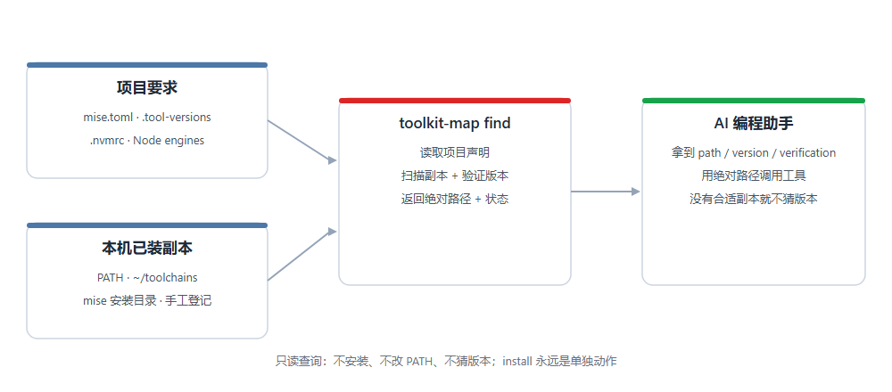

<div align="center">

# toolkit-map

**让 AI 编程助手先查工具、再动手：发现本机已装副本，按项目要求选对版本，只返回可验证的绝对路径。**

[](https://github.com/haxsd/toolkit-map/actions/workflows/ci.yml)
[](https://github.com/haxsd/toolkit-map/releases/latest)
[](LICENSE)
[](docs/platform-notes.md)

简体中文 · [English](README-EN.md) · [首次接入](#首次接入一个项目) · [参考手册](docs/reference.md) · [agent 接入](docs/agent-integration.md) · [更新记录](CHANGELOG.md)

</div>



## 解决的问题

AI 编程助手执行 `node`、`python`、`git` 时，通常直接走 PATH。于是：

- PATH 上是 Node 16，而项目声明要求 Node 22 —— 构建失败，agent 反复试错；
- 机器上装着多个副本（PATH、`~/toolchains`、mise 安装目录），agent 不知道选哪个；
- `node --version` 只能说明"当前 PATH 是谁"，不说明"这个项目需要谁"。

toolkit-map 在调用前回答三个问题：

1. **项目要求什么版本？** 读取 `mise.toml`、`.tool-versions`、`.nvmrc`、Node `engines` 等常见声明；
2. **本机有哪些已验证的副本？** 扫描 PATH、工具仓库、mise 安装目录和手工登记的位置；
3. **这次该用哪个绝对路径？** 返回 `path`、`version`、`verification` 和 `requirement`。

**只查询，不安装、不改 PATH、不猜版本。** 没有满足要求的副本时返回 `version_mismatch`，而不是退回旧版本；声明无法解释时返回 `requirement_unsupported`，交给版本管理器或人来处理。

## 和直接 PATH / mise / asdf 的区别

| | 直接 PATH | mise / asdf | toolkit-map |
|---|---|---|---|
| 知道项目要求 | 否 | 是 | 是（读取常见声明） |
| 发现本机已有副本 | 只知道一个 | 只管自己安装的 | PATH、工具仓库、mise 安装目录、手工登记 |
| 返回可验证的绝对路径 | 否 | 部分场景 | 是（`version` + `verification` + `requirement`） |
| 需要安装 / 改 PATH | — | 需要 | 不需要（`install` 是单独的显式动作） |
| 覆盖场景 | 单版本 | 多版本 | 多版本 + Windows 上已有的多套工具 |

> toolkit-map 不替代 mise / asdf：它补齐"项目要求 → 本机哪个副本 → 绝对路径"这一链，安装仍交给版本管理器，或在明确需要时执行一次 `install`。

## 效果示例

假设 PATH 上是 Node 16，机器另有 Node 22，项目声明需要 Node 22：

| 场景 | toolkit-map 返回 | agent 接着做什么 |
|---|---|---|
| 发现可验证的 Node 16、22 | 选择满足项目要求的 Node 22，返回绝对路径 | 用该路径调用工具 |
| 本次范围只发现 Node 16 | `version_mismatch`，不给错误版本的调用路径 | 报告缺口，明确需要时再安装 |
| 声明无法解释 | `requirement_unsupported` | 澄清要求或交给管理器，不猜版本 |

成功查询的关键字段（示例路径，不是你本机的清单）：

```json
{
  "ok": true,
  "status": "ok",
  "path": "C:\\tools\\node\\22\\node.exe",
  "version": "22.23.2",
  "verification": "verified",
  "requirement": { "version": "22", "scope": "project", "source": "C:\\project\\mise.toml" }
}
```

## 首次接入一个项目

**要求**：Windows + Windows PowerShell 5.1 或 PowerShell 7 + Git。想用 MCP 接入时另需 Node.js 18+；地图本身不依赖 Node。

想先看效果？在源码目录运行 `.\scripts\demo.ps1`（临时地图，不改本机）。想一次完成下载、项目接入并生成 MCP 配置：

```powershell
$d = Join-Path $env:USERPROFILE 'Projects\toolkit-map'
git clone --branch v1.1.3 --depth 1 https://github.com/haxsd/toolkit-map $d
& powershell -NoProfile -ExecutionPolicy Bypass -File "$d\scripts\quickstart.ps1" -Project (Get-Location).Path -Mcp -WriteMcp
```

`quickstart` 只写项目 `AGENTS.md` 并打印 MCP 配置，不覆盖客户端已有的服务器配置。已经运行上面的块时可直接跳到第 2 步；下面是分步说明。加 `-WriteMcp` 可直接写入项目级 Cursor `.cursor/mcp.json`（默认）或 Claude Code `.mcp.json`（`-McpClient claude` / `both`），修改前备份并保留其他服务器。

### 1. 下载稳定版

在要接入的项目目录打开 PowerShell，按顺序执行（当前目录就是项目路径）：

```powershell
$project = (Get-Location).Path
$installDir = Join-Path $env:USERPROFILE 'Projects\toolkit-map'
git clone --branch v1.1.3 --depth 1 https://github.com/haxsd/toolkit-map $installDir
if ($LASTEXITCODE -ne 0) { throw '下载未完成。已有安装请按升级指南处理，不要覆盖。' }
$map = Join-Path $installDir 'scripts\map.ps1'
$ps = (Get-Process -Id $PID).Path
# 下面统一用 toolkit 调用，它等价于「用当前 PowerShell 宿主单次运行 map.ps1」
function toolkit { & $ps -NoProfile -ExecutionPolicy Bypass -File $map @args }
```

已有安装见[升级步骤](docs/agent-integration.md#升级与刷新规则)。没有 Git 或希望下载 ZIP 时，改走 [ZIP 接入路线](docs/agent-integration.md#没有-git-时从-zip-接入)。

### 2. 预览并接入项目

```powershell
toolkit setup -Project $project -WhatIf -Json
toolkit setup -Project $project
toolkit doctor -Project $project -Json
toolkit find git -Project $project
```

`setup` 首次建图，并把规则写入项目的 `AGENTS.md`（已有内容保留，修改前备份）。它不安装运行时、不改 PATH；首次扫描耗时取决于候选数量与探测情况。

`doctor` 正常时返回 `ok: true`、`status: ok`；`find git` 显示绝对路径、版本与 `验证 verified`。异常时按 `checks` 排查，见[故障排查](docs/troubleshooting.md)。

### 3. 在 agent 里验收

在同一项目新开一个 Cursor Agent Chat 或 Codex 会话，发送：

> 根据本项目的工具发现规则，查询 Git。先不安装、不改环境；报告项目要求、发现的副本、所选绝对路径及验证状态。验证通过后，用这个绝对路径执行 `--version`。

成功标志是看到 agent **实际调用地图，再调用返回的工具路径**。`doctor` 只检查本机配置，不能证明模型已加载或遵守规则；模型直接调用裸 `git` 时，按[规则未生效的排查步骤](docs/troubleshooting.md)处理。

### 常用命令

```powershell
toolkit status -Json                        # 地图新鲜度、PATH 变化
toolkit find node -Project $project -Json   # 项目要求 + 绝对路径
toolkit add node -Path 'C:\existing-node\node.exe' -Json   # 登记已有副本
toolkit install rg@latest -WhatIf -Json     # 查看安装计划，不联网
```

完整命令、结果状态、适配器与声明规则见[参考手册](docs/reference.md)。

## 用 MCP 接入（推荐）

客户端支持 MCP 时，不需要把规则文件粘进每个项目：让地图选一个 Node 18+ 绝对路径，生成配置，粘贴一次即可。下面假设你已经按上一步设置了 `$map` 与 `$installDir`。

```powershell
# 1. 用地图找一个已验证的 Node 18+，不要用 PATH 上的旧版本
$node = (& $map find node -Version '>=18' -Json | ConvertFrom-Json).path

# 2. 生成 Cursor / Claude Code 的 mcpServers JSON；Codex 用 --print-config codex
& $node (Join-Path $installDir 'mcp\server.mjs') --print-config

# 3. 先脱离客户端验证服务器和地图
& $node (Join-Path $installDir 'mcp\server.mjs') --check
```

把输出合并进 Cursor 的 `~/.cursor/mcp.json`（或项目 `.cursor/mcp.json`）、Claude Code 的 `.mcp.json`，或按 TOML 粘进 `~/.codex/config.toml`，重启客户端。新会话里应能看到 `toolkit_find`、`toolkit_status`、`toolkit_doctor` 三个只读工具。

MCP 与规则文件可以同时启用；MCP 不会自动改写 `AGENTS.md`，`setup` 也不会替你写 MCP 配置。完整配置、协议版本与故障排查见 [MCP 接入](docs/mcp.md)。

## 接入前端

| 前端 | 跨项目使用 | 只在当前项目使用 |
|---|---|---|
| Cursor | Customize → Rules → User Rules（手工粘贴） | 项目 `AGENTS.md`，或带 `alwaysApply` 的 MDC |
| Codex | `CODEX_HOME/AGENTS.md`，默认 `~/.codex/AGENTS.md` | 项目 `AGENTS.md` |
| Claude Code | `~/.claude/CLAUDE.md` | 项目 `CLAUDE.md` |

任何能读取规则文件的 agent 都可以接入。完整位置、模板与生效验收见 [agent 接入指南](docs/agent-integration.md)。

## 能力范围

| 能力 | 当前支持 | 边界 |
|---|---|---|
| 发现已有工具 | 已登记路径、PATH、统一仓库、mise 安装目录，以及扫描内核识别的位置 | 非穷尽全盘；其他位置可用 `add` 登记 |
| 验证与选择 | 运行时与 CLI 的路径、版本、验证状态；按项目要求选择 | 未知工具默认尝试 `--version`；特殊参数需适配器；**没有声明时尊重系统默认，不主动升级到最新** |
| 项目声明 | 常见 `mise.toml`、`.tool-versions`、Node/Python 版本文件和 Node `engines` | 轻量读取器，不解释完整 TOML / mise 环境语义 |
| portable 安装 | gh、jadx、rg/ripgrep、fd（Windows x64）、adb；自定义 ZIP | 不自动安装所有能发现的工具；下载版本在最终位置再次验证 |
| 安装器 | 明确使用 `-Via winget` | 位置由包管理器决定 |
| MCP 接入 | `toolkit_find` / `toolkit_status` / `toolkit_doctor`，零 npm 依赖 | 需要 Node.js 18+；只读，不暴露安装与扫描 |
| 接口契约 | v1.0 冻结 JSON result v2、地图 v2、30 项状态枚举与 MCP 工具契约 | 兼容与弃用策略见[契约冻结](docs/contract.md) |
| 平台 | Windows PowerShell 5.1 / 7 支持完整地图 | Unix 目前仅 `census.sh` 扫描内核 |

## 安全边界

- **默认只读**：`scan` / `status` / `find` / `doctor` 不安装工具、不改 PATH、不写配置；
- **安装是独立动作**：`install` 需要显式调用，建议先用 `-WhatIf` 查看计划，不联网；
- **改文件先备份**：`setup` 只维护你指定的规则文件，已有内容保留、修改前备份；
- **验证状态明确**：`verified` / `unverified` / `unavailable` / `skipped` 不混用，未经验证的副本不会默认被选中；
- **不碰凭据**：本机地图、工具、缓存和凭据不进入发布包；
- **不修改全局执行策略**：用当前宿主单次调用，组织组策略的限制照常遵守。

## 文档

[参考手册](docs/reference.md) · [契约冻结](docs/contract.md) · [MCP 接入](docs/mcp.md) · [2 分钟演示](docs/demo.md) · [agent 接入](docs/agent-integration.md) · [平台说明](docs/platform-notes.md) · [存储与大工具安装](docs/storage.md) · [故障排查](docs/troubleshooting.md) · [撤销与卸载](docs/uninstall.md) · [贡献指南](docs/contributing.md) · [安全策略](SECURITY.md) · [更新记录](CHANGELOG.md)

## 常见问题

- **没有项目声明时，会帮我选到最新的版本吗？** 不会。选择顺序是 `-Version` 参数 > 项目声明 > 父目录/全局声明 > 系统默认（PATH 上的那个）。PATH 上是 Node 16、机器另有 Node 24 时，`find node` 返回 16；要特定版本就写项目声明或传 `-Version`。
- **会把工具搬走或改 PATH 吗？** 扫描和接入不会；已有副本留在原处。`install` 是单独的明确操作。`bootstrap` 是可选环境配置，会修改机器，不在上述接入流程中。
- **必须用 mise 吗？** 不用。没有 mise 也能发现、登记和查询工具；项目需要完整管理器环境时再使用 mise。
- **工具默认放 C 盘吗？** 地图默认在 `~/.toolkit/map.json`，新的 portable 工具默认在 `~/toolchains`。`TOOLCHAIN_ROOT` 可改仓库位置，见[存储指南](docs/storage.md)。
- **能撤销吗？** 可以移除接入规则与技能链接，保留已有工具，见[撤销与卸载](docs/uninstall.md)。
- **升级后会自动生效吗？** 源码更新不等于旧规则更新。文件规则重跑 `setup`；Cursor 全局 User Rules 重新生成并粘贴；随后新开会话验收。

## 贡献与许可

欢迎 Issue 和 PR：先看[贡献指南](docs/contributing.md)，Bug 与功能建议请用 [Issue 模板](https://github.com/haxsd/toolkit-map/issues/new/choose)，尽量附上复现步骤与 `doctor -Bundle -Json` 输出（粘贴前隐去路径中的用户名）。

源码、协议、通用示例与配方使用 [MIT](LICENSE) 许可。本机地图、工具、缓存和凭据不进入发布包。
