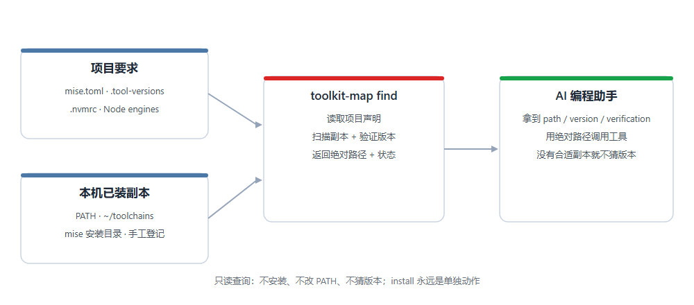

<div align="center">

# toolkit-map

**让 AI 编程助手先查工具、再动手：发现本机已装副本，按项目要求选对版本，只返回可验证的绝对路径。**

[](https://github.com/haxsd/toolkit-map/actions/workflows/ci.yml)
[](https://github.com/haxsd/toolkit-map/releases/latest)
[](LICENSE)
[](docs/platform-notes.md)

简体中文 · [English](README-EN.md) · [快速开始](#快速开始) · [参考手册](docs/reference.md) · [agent 接入](docs/agent-integration.md) · [更新记录](CHANGELOG.md)

</div>



## 解决的问题

AI 编程助手执行 `node`、`python`、`git` 时通常直接走 PATH：PATH 上是 Node 16，项目声明要求 Node 22；机器上装着多份副本，agent 不知道选哪个；`node --version` 只说明 PATH 解析到谁，不说明这个项目需要谁。

toolkit-map 在调用前回答三件事：

1. **项目要求什么版本？** 读取 `mise.toml`、`.tool-versions`、`.nvmrc`、Node `engines` 等常见声明；
2. **本机有哪些已验证的副本？** 扫描 PATH、统一仓库、mise 安装目录和手工登记的位置；
3. **这次该用哪个绝对路径？** 返回 `path`、`version`、`verification` 和 `requirement`。

**查询严格只读，不安装、不改 PATH、不猜版本。** 地图维护（`scan` / `update` / `add`）是单独动作；`setup` 默认预授权 agent 在 `find` 返回维护建议时自动执行定向 `update <tool>`，未执行 `setup` 时不预授权；`scan` / `add` / `install` 仍需用户确认。没有满足要求的副本时返回 `version_mismatch`，不降级；声明无法解释时返回 `requirement_unsupported`，交给版本管理器或人处理。与其他工具的区别和返回示例见[参考手册](docs/reference.md#和其他工具的区别)。

## 快速开始

**要求**：Windows + Windows PowerShell 5.1 或 PowerShell 7 + Git。想用 MCP 接入时另需 Node.js 18+；地图本身不依赖 Node。

一次完成下载、项目接入并写入项目级 MCP 配置：

```powershell
$project = (Get-Location).Path
$d = Join-Path $env:USERPROFILE 'Projects\toolkit-map'
git clone --branch v2.0.0 --depth 1 https://github.com/haxsd/toolkit-map $d
if ($LASTEXITCODE -ne 0) { throw '下载未完成。已有安装请按升级指南处理，不要覆盖。' }
$ps = (Get-Process -Id $PID).Path
& $ps -NoProfile -ExecutionPolicy Bypass -File "$d\scripts\quickstart.ps1" -Project $project -Mcp -WriteMcp
```

看退出码：`0` 全部完成；`2` 部分完成（规则已接入，MCP 未写成，例如没有 Node 18+ 或启动检查失败）；`1` 项目接入失败。`-ExecutionPolicy Bypass` 只作用于该子进程，不修改用户或机器策略；组织策略拒绝时按组织流程申请，不要改注册表或组策略。

手动完成同样的步骤：

```powershell
$project = (Get-Location).Path
$installDir = Join-Path $env:USERPROFILE 'Projects\toolkit-map'
git clone --branch v2.0.0 --depth 1 https://github.com/haxsd/toolkit-map $installDir
$map = Join-Path $installDir 'scripts\map.ps1'
$ps = (Get-Process -Id $PID).Path
function toolkit { & $ps -NoProfile -ExecutionPolicy Bypass -File $map @args }
toolkit setup -Project $project -WhatIf -Json   # 预览
toolkit setup -Project $project                 # 建图并把规则写入 AGENTS.md
toolkit doctor -Project $project -Json          # 只读诊断
toolkit find git -Project $project              # 只读查询
```

已有安装见[升级步骤](docs/agent-integration.md#升级与刷新规则)；没有 Git 或希望下载 ZIP 时走 [ZIP 接入](docs/agent-integration.md#没有-git-时从-zip-接入)。MCP 客户端可以直接调用地图工具，配置、协议与验收见 [MCP 接入](docs/mcp.md)；规则位置、模板与生效验收见 [agent 接入](docs/agent-integration.md)。

## 安全边界

- **查询只读**：`status` / `find` / `doctor` 不安装工具、不改 PATH、不写配置；`find` 不执行新候选、不写地图。
- **维护与安装是显式动作**：`scan` / `update` / `add` 会写地图并可能探测本机候选程序；`install` 需要单独调用，建议先 `-WhatIf`。MCP 维护默认只预览，`confirm:true` 只是执行请求，仍需用户授权。
- **不动已有环境**：不迁移已有工具、不改 PATH、不改全局执行策略，也不碰凭据。
- **团队仓库**：接入规则和 MCP 配置含本机绝对路径，不要提交到共享仓库；每位成员本地生成。
- 本机地图、工具、缓存和凭据不进入发布包；完整边界见[安全策略](docs/security-policy.md)。

## 文档

[参考手册](docs/reference.md) · [契约冻结](docs/contract.md) · [MCP 接入](docs/mcp.md) · [2 分钟演示](docs/demo.md) · [agent 接入](docs/agent-integration.md) · [平台说明](docs/platform-notes.md) · [存储与大工具安装](docs/storage.md) · [故障排查](docs/troubleshooting.md) · [撤销与卸载](docs/uninstall.md) · [开发与贡献](docs/development.md) · [安全策略](docs/security-policy.md) · [更新记录](CHANGELOG.md)

## 常见问题

- **没有项目声明时会选最新版吗？** 不会。顺序是 `-Version` > 项目声明 > 父目录/全局声明 > 系统默认；PATH 上是 Node 16 就返回 16，要特定版本请写声明或传 `-Version`。
- **会搬走工具或改 PATH 吗？** 不会；已有副本留在原处，`install` 是单独的明确操作。
- **必须用 mise 吗？** 不用；没有 mise 也能发现、登记和查询，需要完整管理器环境时再用。
- **能撤销吗？** 可以移除接入规则、MCP 配置与技能链接，保留已有工具，见[撤销与卸载](docs/uninstall.md)。

## 贡献与许可

欢迎 Issue 和 PR：先看[开发与贡献](docs/development.md)，Bug 与功能建议请用 [Issue 模板](https://github.com/haxsd/toolkit-map/issues/new/choose)，尽量附上复现步骤与 `doctor -Bundle -Json` 输出（粘贴前隐去路径中的用户名）。

源码、协议、通用示例与配方使用 [MIT](LICENSE) 许可。
